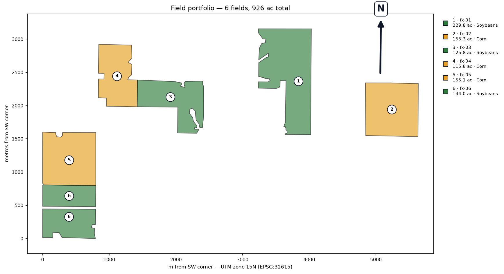
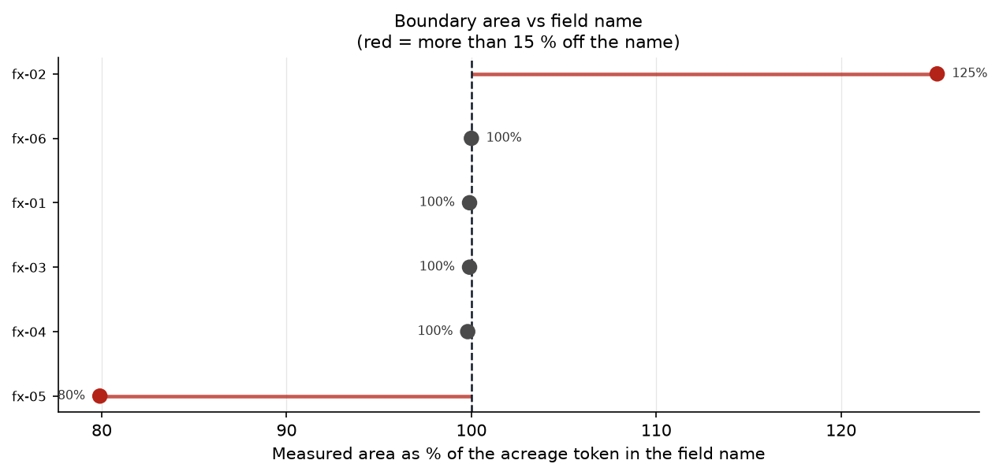
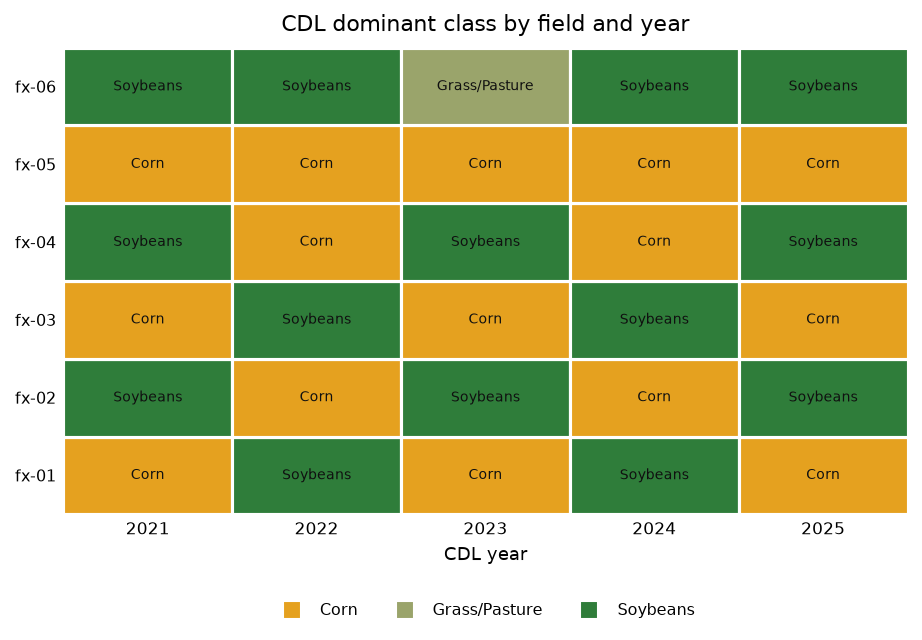
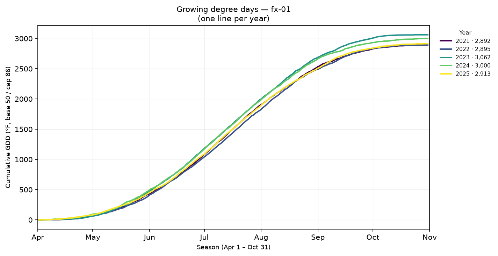

# eda-field examples

Four figures are committed here because together they show the shape of the
subskill: a map, a boundary check, a rotation table, and a weather curve. The
other six artifacts are produced on demand by a real run, so the gallery stays
small and reviewable.

All four are rendered from a deterministic synthetic fixture, not from a
customer farm. Geometry comes from the committed
`field-management/field-boundaries/examples/real_10_fields_iowa.geojson`; the
weather and CDL tables are generated by `fixture/build_fixture.py`. Every number
is therefore reproducible without shipping grower data.

## Committed figures

### Field portfolio



Six numbered footprints at true relative position in local metre axes, with a
true-north arrow and no rotation (rotating a portfolio is meaningless). The key
carries field ID, acreage, and planted crop. The split parcel (`fx-06`) is
numbered in both parts so it does not look like an unlabelled field.

### Boundary area vs field name



Measured acreage as a share of the acreage token in the field name. Two fields
were built to disagree: `fx-02` over-draws its name by 25 %, `fx-05` under-draws
by 20 %. The red threshold is 15 %. A flagged bar means the name is unreliable,
not the polygon.

### CDL dominant class by year



One row per field, one column per CDL year. Four fields alternate corn and
soybeans, `fx-05` is continuous corn, and `fx-06` has a grass-dominated 2023 —
the edge-mixing case that makes purity worth plotting. A dominant class is a
rotation outcome, not a claim that another source is wrong.

### Growing degree days



Cumulative GDD for one field, one line per year, with season totals in the key.
Because every field shares one weather series in this fixture, the lines are
identical across fields by construction; the figure shows year-to-year spread,
not spatial spread.

## Reproduce

```bash
"${DATA_PIPELINE_DATA_ROOT}/data-pipeline/.venv/bin/python" \
  my-farm-advisor/eda/eda-field/examples/render_examples.py
```

The script builds the fixture in a temporary directory, runs
`scripts/field_eda.py` over it, and copies the four chosen PNGs back to
`output/`. Pass `--keep` to inspect the full ten-artifact run and its CSVs.

To build the fixture alone:

```bash
python examples/fixture/build_fixture.py --out /tmp/eda-field-fixture
```

Outputs: `boundaries.geojson`, `weather.csv`, `cdl.csv`, `planted.json`, and
`fixture_manifest.json`. `--temp-offset` shifts the weather for a second
synthetic grower, which the smoke test uses to exercise the cross-grower path.
